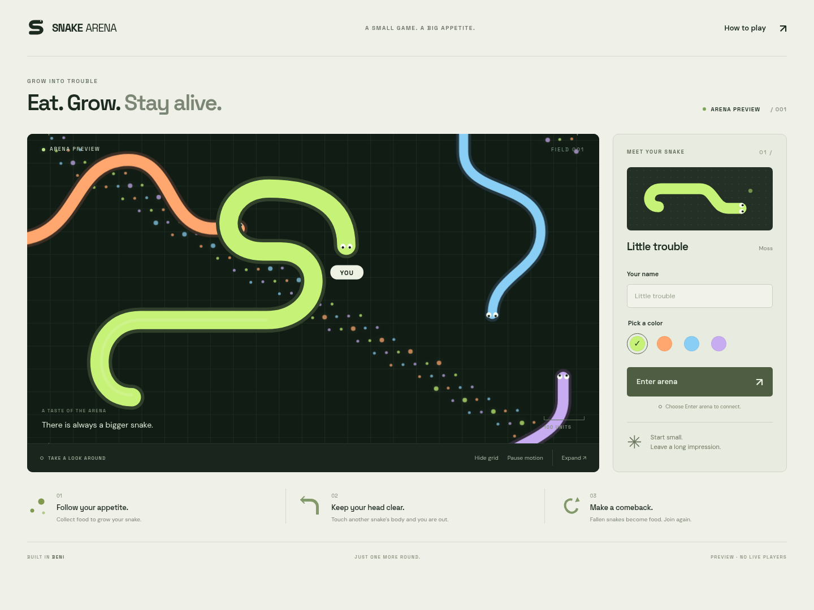

# Snake Arena

A small multiplayer snake game in beni.
One Cloudflare Durable Object owns each arena.
The browser sends input and draws interpolated SVG snapshots from the server.

Eat food to grow. Avoid other snakes and the arena wall.
A dead snake becomes food. Choose **Enter arena** to join again.
The score list shows the five longest live snakes.
The initial arena remains a separate illustration until you connect.



All game source and test assertions use beni.
The compiler produces JavaScript. Do not edit that output.
The tests reuse beni's unchanged Miniflare driver.

## Run locally

```sh
nix develop .#workers
scripts/dev.sh
```

Open `http://127.0.0.1:4173` in two browser tabs.
Choose a name and color in each tab. Choose **Enter arena**.
Move the pointer, drag a finger, or use the arrow keys.
Choose **Leave arena** to return to the preview.
Press Ctrl-C in the terminal to stop the local Worker.

The shell builds the pinned beni compiler with Zorg on its first use.
The `workers` shell takes Wrangler and Miniflare from that beni revision's own shell.
It adds no second tools pin. The server listens on `127.0.0.1`.
The command uses local workerd. It needs no Cloudflare account.

## Configure

| Variable | Default | Purpose |
|---|---|---|
| `SNAKE_PORT` | `4173` | Local Worker port |
| `CHROMIUM_PATH` | `chromium` | Browser binary for render checks |

The browser uses `/arena/main/ws`.
The Worker maps each `/arena/<name>/...` route to one named object.
Different arena names use separate state and scores.
The object permits at most 16 sockets.
It runs one simulation step every 50 milliseconds while a snake lives.

The `.envrc` file stays local:

```sh
dotenv_if_exists
use flake
```

After you read that file, run `direnv allow`.
The default shell supports builds and lint. The `workers` shell also supports local Worker tests.

## Develop

```sh
scripts/build.sh
scripts/lint.sh
scripts/test.sh
scripts/all.sh
scripts/benchmark.sh
```

The scripts select the required Nix shell when necessary.
`test.sh` checks fixed-seed rules, the local Worker with several clients, and desktop and mobile renders.
The Worker checks every client message with the shared schema.
Clients cannot set a snake's position, length, score, or simulation tick.
They send only a join request or an aim point.
The object accepts at most one aim point per player per tick.
The shared Color schema represents each color by name, such as `{"name":"moss"}`.

The local checks currently fail on client close replies in the pinned beni platform.
Both Worker build modes pass the other 14 transcript checks.
See the [check results](docs/checks.md) and [beni issue #724](https://github.com/canassa/beni/issues/724#issuecomment-6352841942).

| Path | Purpose |
|---|---|
| `game/` | Pure rules, seeded random state, and shared schemas |
| `server/` | Worker routing, the authoritative object, sockets, and checkpoints |
| `frontend/` | Lobby, separate preview, live SVG view, CSS, and local fonts |
| `tests/` | Beni rule and transcript checks, plus driver steps |
| `scripts/` | Build, lint, local server, and checks |
| `nix/` | Zorg and beni compiler derivations |
| `build/` | Generated pages, Worker modules, and test programs |
| `.scratch/` | Local caches, transcripts, logs, and screenshots |

Format the source with `beni fmt game server frontend tests`.
Install commit hooks with `prek install`.
CI runs the same scripts.

## Package

```sh
nix build .#frontend
nix build .#worker
```

`nix build` also builds the static frontend package.
The output keeps each font license beside its font.
There is no release command. Do not deploy this task.

The local Wrangler configuration uses the pinned runtime's compatibility date.
A production account, hostname, and current compatibility date still need a separate deployment task.
See the [deployment notes](docs/deployment.md) and [capability evidence](docs/capabilities.md).

The project uses the [MIT License](LICENSE).
